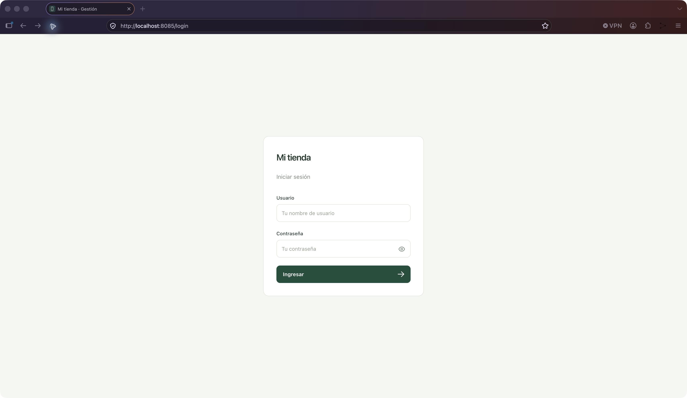

# Phone Sale

**Inventory, sales, and accounting for phone retailers.**

Phone Sale connects the everyday operations of a phone shop: buying stock, tracking individual devices, selling phones and accessories, collecting payments, and managing cash and bank accounts in ARS and USD.

## Features

- Device and accessory inventory, including used-device grades and repair or transit states.
- Supplier purchases, sales, quotations, reservations, deposits, and cancellations.
- Customer records, user authentication, and permissions.
- Cash and bank operations with balances in ARS and USD.
- An editable iPhone catalog and configurable store settings.
- An isolated demo seed with fictional customers and transactions.

## Technology

| Layer | Tools |
| --- | --- |
| Web application | Angular, TypeScript |
| API | NestJS, TypeORM |
| Database | PostgreSQL |
| Delivery | Docker, Nginx, GitHub Actions |
| Validation | API and web tests, database integration tests |

## Preview



*Sign-in screen captured from the local application; no account or customer data is shown.*

## Explore the implementation

- [Architecture](docs/ARCHITECTURE.md): application structure and design decisions.
- [Testing](docs/TESTING.md): scenarios, coverage, and validation boundaries.
- [Deployment](deploy/README.md): container setup and deployment workflow.
- [Source provenance](docs/SOURCES.md): origins of the code incorporated into this repository.

## Run locally

Use Node 22.22.3 (or compatible Node 24.15+) (see `.nvmrc`) and Docker.

```sh
npm run setup
cp api/.env.example api/.env
# Set JWT_SECRET and SEED_ADMIN_PASSWORD in api/.env.
npm run db:up
npm run db:migrate
npm run db:seed
```

Start in separate terminals:

```sh
npm run dev:api
npm run dev:web
```

- Web: http://localhost:4300
- API: http://localhost:3210/api
- PostgreSQL: localhost:5441, database `phone_sale_app`
- Login: `SEED_ADMIN_USERNAME` / `SEED_ADMIN_PASSWORD` from your ignored `api/.env`.

`db:seed` aliases the starter seed. It creates the administrator, USD/ARS accounts, boxes, banks, suppliers, required parameters and the iPhone catalog. It preserves passwords, balances and existing operations. Configure the store name under **Configuración → Tu tienda** and the manual exchange rate under **Cotización del dólar**. There is no automatic rate synchronization. The initial route opens inventory; promotional dashboard and login branding have been removed.

## Starter and demo data

Edit only the display labels in [`api/src/database/seed-labels.ts`](api/src/database/seed-labels.ts), leaving the object keys unchanged, then run:

```sh
npm run db:seed:starter
```

Rerunning updates the same setup rows and their account names without changing balances or credentials. A store name edited in the UI takes precedence over a previously seeded label. `STORE_NAME` optionally overrides the initial store label. Set the administrator username/password in `api/.env`; no credentials are hardcoded in the seed. The starter creates no customers, stock, sales or invented price references. Its dollar reference starts at zero until configured manually.

For a populated local demonstration:

```sh
npm run db:seed:demo
```

The demo requires `NODE_ENV=development`, also runs the starter, and adds 8 fictional customers, 6 stocked accessories, one device per catalog model plus 60 additional phones concentrated on the latest 14 models, illustrative price references, recommended accessories and battery adjustments. It includes supplier purchases and a partial payment, paid cash/bank sales, a reservation with deposit, a pending quotation, a credit sale, a cancelled sale, and devices in transit and repair. Stock and accounting movements are produced by the application services in a single transaction. The dashboard extension adds 30 orders with mixed phone/accessory items, 26 completed sales spread across the last 90 days, additional pending/deposited orders, historical exchange rates, payments in USD/ARS to both cash and bank accounts, and damaged/lost/repair/transit stock. Separate persistent version markers prevent duplicate operations on reruns and let an existing base demo receive the extension without a reset. It preserves an existing positive dollar reference, or initializes the demo to the fictional value of ARS 1500/USD. Used-device grades are restored as an editable starter catalog in `STARTER_LABELS.equipmentGradings`; the demo assigns grades to its used phones. No seed deletes or resets existing data. The demo marker describes the loaded version; use a separate empty database for a new demo rather than deleting the marker.

The frozen catalog contains 39 iPhone models from iPhone 8 onward, each with its own storage capacities and colors, based on [Apple’s model identification guide](https://support.apple.com/en-us/108044) checked on October 9, 2026. Color swatches are approximate. iPhone 8 and iPhone 8 Plus are separate models; Apple did not release an iPhone 8 Pro. Only the demo supplies fictional prices; starter prices remain unset.

## Verify

```sh
npm run build
npm run test:api
npm run test:web
npm run test:web:coverage
npm run test:integration
# Or all tests:
npm test
```

API unit tests cover password verification (including legacy hashes) and permissions. Web tests cover every route, business dialogs, authentication and permissions, asynchronous rendering, catalog editing, sales and continuation, purchase drafts, payments, accounting transfers, client/user forms and shared controls. The suite uses the actual Angular templates/router with isolated HTTP responses and does not touch your development database. Run `npm run test:web:coverage` for the HTML report in `web/coverage/phone-sale/index.html`. CI enforces minimum coverage of 80% statements/lines and 75% branches/functions. See [frontend testing](docs/TESTING.md) for scenarios and boundaries. Integration tests exercise the real API and native TypeORM repositories: fresh/repeated migrations, login, accounts, model relations, purchases, sale quantities, stock, balances, cancellation, deposit continuation, soft deletion, transaction rollback, settings validation, both seeds, stable editable labels, repeat runs and demo accounting coherence.

Integration tests create and drop only a uniquely named `phone_sale_test_*` database; the configured PostgreSQL user needs database-creation permission. They do not reset your development database.

## Containers

Seed the local database first, then run:

```sh
npm run app:up
```

The web application is served at http://localhost:8085, with `/api/` proxied by Nginx. The API applies compiled TypeORM migrations at startup. For a newly deployed empty database, run `docker compose -f docker-compose.yml -f compose.app.yaml exec api npm run seed:starter:prod` after configuring its seed credentials. Edit labels before building the image. PostgreSQL data and uploads use named volumes. `npm run app:down` stops the application without deleting volumes. This is a local stack. For the isolated Contabo installation with HTTPS and backups, see [deployment](deploy/README.md).

## Database changes

```sh
npm run migration:generate --prefix api -- src/database/migrations/DescribeChange
npm run db:migrate
```

Schema synchronization is disabled. This baseline targets a fresh database; importing an existing Prisma production database requires a separately reviewed data migration. See [docs/ARCHITECTURE.md](docs/ARCHITECTURE.md) for boundaries and transaction behavior.

No commits or remote publication are performed by initialization.
